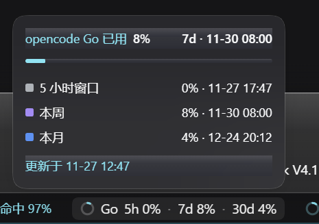

# dsh-go-quota

在 [DSH（DeepSeek Harness）](https://github.com/deepseek-ai/deepseek-harness) Web 界面的输入框旁，加一颗 **OpenCode Go 用量** 胶囊。

```
◔ Go 5h 1% · 7d 8% · 30d 4%
```

点一下弹出明细面板：

- 表头 `opencode Go 已用 8%`（取三档里用得最狠的那一档）
- 4px 进度条
- 三行明细：`5 小时窗口` / `本周` / `本月`，各自百分比 + 重置时间
- 底部 `更新于 …`



颜色、字号、圆角全部走 DSH 的主题 token（`--dsw-*`），跟旁边的 token 速率、缓存命中、上下文用量那几颗胶囊同一套观感；暗色/亮色主题自动跟随。

## 安装

前提：DSH 0.2.x（Web 界面）+ 一个 OpenCode Go 订阅。

```bash
git clone https://github.com/DreamRepair/dsh-go-quota.git
```

把仓库目录作为本地 bundle 装进当前 profile：

- 图形界面：插件页 → 高级 → 安装本地插件，选中仓库目录
- 或者让 agent 执行：`plugin_manager install_bundle target="<仓库绝对路径>"`

装完刷新页面（Ctrl+R），胶囊就出现在输入框右下角。

> 本地目录安装是软链，之后改 `client.js` 刷新页面即可生效；改 `index.js` 需要重启 DSH。

## API Key

主机侧要能读到 OpenCode Go 的 key，按下面的顺序解析：

1. DSH 凭据里的 `OPENCODE_GO_API_KEY`（推荐：`~/.dsh/.credentials.yaml` 的 `refs` 段，或同名环境变量）
2. 兜底：直接读 `~/.dsh/.credentials.yaml`

key 只在本地使用，请求只发往 `https://opencode.ai`，不经过任何第三方，也不会写进日志或响应体。

## 它是怎么工作的

| 文件 | 位置 | 作用 |
| --- | --- | --- |
| `index.js` | 主机进程 | 注册 `GET /go-quota/usage`，做连接鉴权，代浏览器请求上游，内存缓存 30 秒 |
| `client.js` | 浏览器 | 在 `conversation.composer.dock` 槽位注册胶囊，每 60 秒轮询上面的路由 |
| `cordis.patch.yml` | — | DSH bundle 的插件行：`id: go-quota` / `name: dsh-go-quota` |

浏览器拿不到也不能拿 API key，所以必须由主机侧代理一次；30 秒缓存是为了让多个窗口/多次刷新只打一次上游。

## 已知限制

- 上游只返回**已用百分比**（`percent`），没有绝对余额，所以做不出「还能跑多少 token」
- OpenCode Go 的 5 小时 / 本周 / 本月三档是**共享一个池子**的，官方文档写的按模型限额与实际行为不一致（见 [opencode#60311](https://github.com/anomalyco/opencode/issues/60311)），因此这里显示的百分比是账户级的，不是单模型级的
- 只有 Web 平台；终端界面没有这个槽位

## License

MIT
